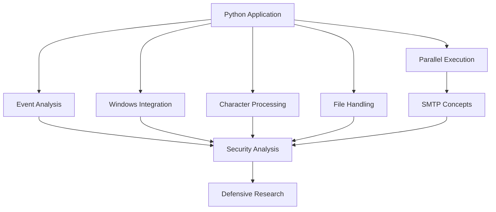

# ⌨️ Keyboard Monitoring Lab

### Python · Windows · Cybersecurity Research · Security Awareness

<p align="center">
  
  
  
  
</p>

---

> [!WARNING]
> **Educational Security Research**
>
> Projeto desenvolvido exclusivamente para estudos, pesquisa e conscientização em segurança da informação.
>
> O tema envolve mecanismos de monitoramento de teclado, que podem representar riscos à privacidade e à segurança de dados. Os exemplos disponibilizados neste repositório são demonstrativos e não implementam captura persistente ou transmissão de entradas de usuários.

## 📌 Sobre o projeto

O Keyboard Monitoring Lab é um projeto de estudos desenvolvido em Python, com foco na compreensão de mecanismos de monitoramento de eventos de teclado em ambientes Windows.

A pesquisa aborda conceitos de interação com o sistema operacional, tratamento de caracteres especiais, manipulação de arquivos, execução paralela e comunicação SMTP.

Além dos aspectos de programação, o projeto explora os riscos associados a ferramentas de captura de entrada, incluindo exposição de credenciais, monitoramento não autorizado e exfiltração de informações.

**Objetivo principal:** compreender como essas tecnologias funcionam e como seus comportamentos podem ser identificados e analisados sob uma perspectiva defensiva.

## 📑 Índice

- [Objetivos](#-objetivos)
- [Tecnologias](#-tecnologias-utilizadas)
- [Arquitetura](#-arquitetura-conceitual)
- [Módulos estudados](#-módulos-estudados)
- [Exemplos de código](#-exemplos-demonstrativos)
- [Análise de segurança](#-análise-de-segurança)
- [MITRE ATT&CK](#-mapeamento-mitre-attck)
- [Medidas defensivas](#-medidas-defensivas)
- [Referências](#-referências)
- [Disclaimer](#️-disclaimer)

## 🎯 Objetivos

- Estudar eventos de teclado e suas representações em Python.
- Compreender a diferença entre caracteres e teclas especiais.
- Analisar o tratamento de caracteres Unicode e acentuação.
- Conhecer a interação entre aplicações Python e o Windows.
- Compreender conceitos de threads e execução paralela.
- Estudar comunicação SMTP e estruturação de mensagens MIME.
- Identificar riscos associados ao monitoramento de entrada.
- Conhecer técnicas de detecção e prevenção de ameaças.

## 🧰 Tecnologias utilizadas

| Tecnologia | Aplicação |
|---|---|
| Python | Desenvolvimento e lógica |
| pynput | Estudo de eventos de teclado |
| pywin32 | Integração com Windows |
| threading | Execução paralela |
| datetime | Datas e horários |
| time | Controle temporal |
| os | Manipulação de arquivos |
| smtplib | Comunicação SMTP |
| MIME | Estrutura de mensagens |

## 🏗️ Arquitetura conceitual

O projeto original foi dividido em cinco componentes funcionais. O diagrama abaixo representa os conceitos estudados, não uma sequência operacional de coleta e transmissão de informações.



## 🔬 Módulos estudados

### 01 — Event Handling

Estudo de eventos de teclado e representação de teclas comuns e especiais.

**Conceitos:**
- Callbacks.
- Listeners.
- Eventos.
- Teclas especiais.
- Tratamento de exceções.

### 02 — Character Processing

Análise de caracteres especiais, Unicode e comportamento de teclas mortas.

**Conceitos:**
- Dicionários.
- Conjuntos.
- Unicode.
- UTF-8.
- Caracteres acentuados.

### 03 — Windows Integration

Estudo da integração entre aplicações Python e recursos do sistema operacional.

**Conceitos:**
- APIs do Windows.
- Janelas em primeiro plano.
- Processos.
- Permissões.
- Contexto de execução.

### 04 — File Management

Análise de operações de leitura, escrita e persistência de dados.

**Conceitos:**
- Manipulação de arquivos.
- Codificação.
- Tratamento de erros.
- Controle de acesso.
- Proteção de informações.

### 05 — Parallel Execution

Estudo da execução simultânea de tarefas.

**Conceitos:**
- Threads.
- Processos.
- Sincronização.
- Execução em segundo plano.
- Ciclo de vida de tarefas.

### 06 — Email Communication

Estudo da comunicação entre aplicações e servidores de e-mail.

**Conceitos:**
- SMTP.
- TLS.
- MIME.
- Autenticação.
- Proteção de credenciais.

## 💻 Exemplos demonstrativos

Os fragmentos a seguir apresentam conceitos isolados, sem implementar o mecanismo de captura global ou transmissão de dados.

### Tratamento de exceções

```python
try:
    resultado = 10 / 2
    print(resultado)

except ZeroDivisionError:
    print("Operação inválida")
```

### Manipulação de caracteres

```python
TABELA_ACENTOS = {
    "^": {
        "a": "â",
        "e": "ê"
    },
    "~": {
        "a": "ã",
        "o": "õ"
    }
}

print(TABELA_ACENTOS["^"]["a"])
```

### Execução paralela

```python
import threading

def tarefa_demo():
    print("Tarefa demonstrativa")

thread = threading.Thread(target=tarefa_demo)
thread.start()
thread.join()
```

## 🛡️ Análise de segurança

Ferramentas de monitoramento de teclado podem ser utilizadas em atividades maliciosas quando empregadas para capturar informações sem autorização.

### Principais riscos identificados

| Risco | Possível impacto |
|---|---|
| Captura de credenciais | Comprometimento de contas |
| Monitoramento indevido | Violação de privacidade |
| Exposição de dados | Vazamento de informações |
| Comunicação externa | Exfiltração de dados |
| Execução não autorizada | Comprometimento do endpoint |

## 🧭 Mapeamento MITRE ATT&CK

O comportamento estudado possui relação com técnicas documentadas no framework MITRE ATT&CK.

| Técnica | Identificação | Contexto |
|---|---|---|
| Input Capture | T1056 | Captura de entradas |
| Keylogging | T1056.001 | Registro de teclas |
| Exfiltration Over Web Service | T1567 | Exfiltração por serviços web |

Referência: [MITRE ATT&CK](https://attack.mitre.org/)

## 🔐 Medidas defensivas

Para reduzir os riscos associados a mecanismos de monitoramento indevido:

- Utilizar soluções de proteção de endpoints.
- Monitorar aplicações com comportamento suspeito.
- Restringir permissões de execução.
- Aplicar políticas de segurança.
- Proteger credenciais e tokens.
- Monitorar conexões de rede.
- Investigar processos desconhecidos.
- Manter sistemas operacionais atualizados.

## 📚 Referências técnicas

- [Python Documentation](https://docs.python.org/3/)
- [pynput Documentation](https://pynput.readthedocs.io/en/latest/)
- [pywin32 Repository](https://github.com/mhammond/pywin32)
- [MITRE ATT&CK](https://attack.mitre.org/)
- [MITRE T1056 — Input Capture](https://attack.mitre.org/techniques/T1056/)
- [MITRE T1056.001 — Keylogging](https://attack.mitre.org/techniques/T1056/001/)

## ⚖️ Disclaimer

Este projeto possui finalidade exclusivamente educacional e de pesquisa em segurança da informação.

O conteúdo publicado busca demonstrar conceitos de programação, funcionamento de mecanismos de monitoramento e análise de riscos cibernéticos.

Não é destinado à coleta não autorizada de informações, monitoramento de terceiros ou violação de privacidade.

Qualquer estudo envolvendo monitoramento de eventos deve ocorrer em ambiente controlado, com autorização expressa e respeito à legislação aplicável.

---

<p align="center">
  <b>Learn · Analyze · Protect</b>
  <br>
  <sub>Cybersecurity Research | Python | Windows Security</sub>
</p>
